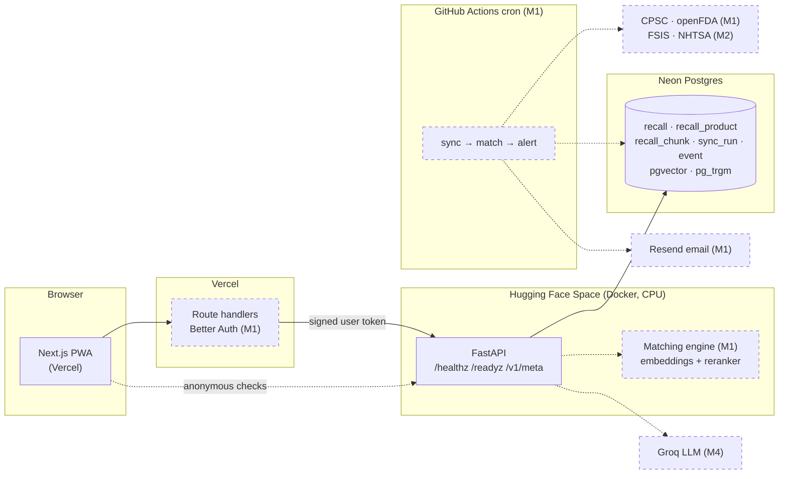
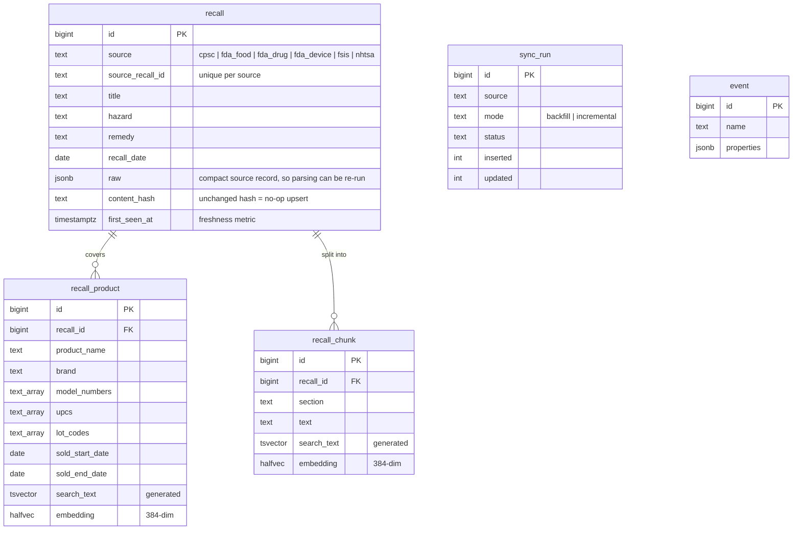

# Architecture

RecallRadar is a Next.js PWA in front of a FastAPI service, backed by one Postgres database that
scheduled GitHub Actions jobs keep filled with official recall data. Everything runs on free tiers
(SPEC §3.2).

## System

Solid boxes exist as of M0; dashed boxes arrive in the milestone noted.

### Request paths

- **Anonymous check** (M1): browser → FastAPI `/v1/check` → candidate generation and scoring in
  Postgres → verdict with evidence. No account needed.
- **Signed-in actions** (M1): browser → Next.js route handler (session via Better Auth) → FastAPI
  with a short-lived token naming the user. FastAPI never reads cookies.
- **Freshness** (M1): GitHub Actions cron runs the ingesters, which upsert into Postgres and log a
  `sync_run`; new recalls are reverse-matched against watched items and alerts go out by email.

### Why this shape

- The landing page and design system are static (prerendered) and don't need the API, so they
  stay fast even while the free Hugging Face Space is waking up.
- One database is the system of record: the API, jobs and evaluation scripts all read the same
  tables, and Alembic migrations in `packages/core` are the only way the schema changes.

## Data model (M0)

The schema follows SPEC §4.3 and will change once ingesters see real data. For example, openFDA's
records are per product and group into a recall by `event_id`.

## Repository layout

| Path | What lives there |
|---|---|
| `apps/web` | Next.js app: pages, design system (`src/design`, `src/components`), Vitest + Playwright |
| `apps/api` | FastAPI service and its Dockerfile (also the Hugging Face Space image) |
| `packages/core` | Settings, JSON logging, SQLAlchemy models, Alembic migrations |
| `packages/ingest` | Source ingesters, normalisation, identifier extraction (M1) |
| `packages/identify` | Input handling → `ProductQuery` (M1–M2) |
| `packages/matching` | Candidate generation, scoring, tiers, evaluation (M1, M3) |
| `packages/ask` | RAG pipeline and evaluation (M4) |
| `packages/earlywarn` | Complaint-surge backtest (M5) |
| `jobs` | Scheduled job entrypoints (M1) |
| `tests` | Cross-package fixtures and integration tests |
| `data/labels` | Hand-labelled evaluation data, no personal data (M3) |
| `docs` | This file, DECISIONS, DESIGN, and evaluation write-ups |
