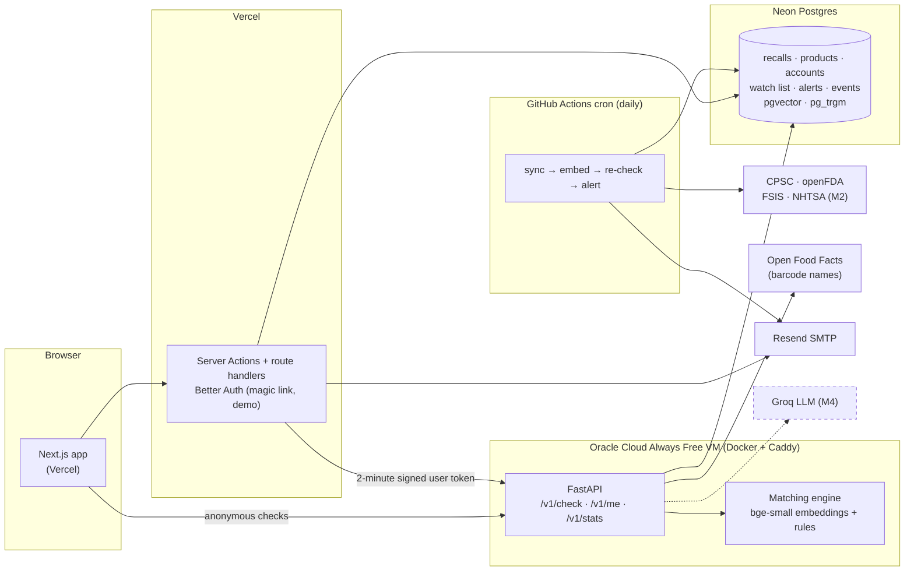
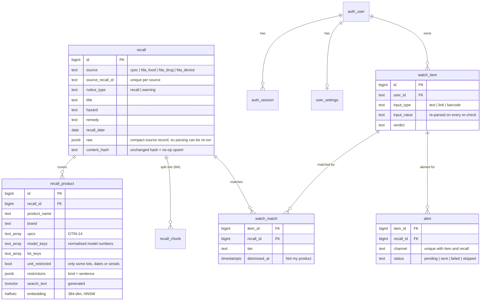

# Architecture

RecallRadar is a Next.js PWA in front of a FastAPI service, backed by one Postgres database that
scheduled GitHub Actions jobs keep filled with official recall data. Everything runs on free tiers
(SPEC §3.2).

## System

Solid boxes exist as of M1; dashed boxes arrive in the milestone noted.

### Request paths

- **Anonymous check:** browser → FastAPI `POST /v1/check` (rate limited per IP) → parse the input
  → candidates from identifiers, full-text, trigram and vector search → tier rules → verdict with
  reasons, what to check, and coverage. Only an event (input type, verdict, latency) is stored.
- **Signed-in actions:** browser → Next.js Server Action (Better Auth session cookie) → FastAPI
  with a 2-minute HS256 token naming the user. The browser never holds that token, and FastAPI
  never reads cookies. Better Auth itself talks to Postgres directly for its own tables.
- **Freshness:** a daily GitHub Actions run syncs CPSC and openFDA incrementally (overlapping
  windows; upserts are idempotent), embeds new products, re-checks every watched item, and emails
  new CPSC matches, at most one alert per item and recall.

### Why this shape

- The landing page and design system are static (prerendered) and don't need the API, so they
  stay fast even if the API is down. The recall counter is a cached component that falls back to
  plain text when the API can't be reached.
- One database is the system of record: the API, the web server's auth, the jobs and the
  evaluation all read the same tables, and Alembic migrations in `packages/core` are the only way
  the schema changes (Better Auth's tables included).

## Data model (M1)

Other tables: `auth_account` and `auth_verification` (Better Auth), `barcode_lookup` (Open Food
Facts cache), `feedback` ("This is mine" / "Not my product" labels, not linked to users),
`sync_run` (one row per ingester run), and `event` (usage counts).

## Repository layout

| Path | What lives there |
|---|---|
| `apps/web` | Next.js app: pages, design system (`src/design`, `src/components`), Vitest + Playwright |
| `apps/api` | FastAPI service and its Dockerfile |
| `deploy/oracle` | Production compose file, Caddy config, cloud-init, and the self-deploy script |
| `packages/core` | Settings, JSON logging, SQLAlchemy models, Alembic migrations |
| `packages/ingest` | Source ingesters, normalisation, identifier extraction (M1) |
| `packages/identify` | Input handling → `ProductQuery` (M1–M2) |
| `packages/matching` | Candidate generation, scoring, tiers, evaluation (M1, M3) |
| `packages/ask` | RAG pipeline and evaluation (M4) |
| `packages/earlywarn` | Complaint-surge backtest (M5) |
| `jobs` | Scheduled job entrypoints (M1) |
| `tests` | Cross-package fixtures and integration tests |
| `data/labels` | Hand-labelled evaluation data, no personal data (`m1_smoke.jsonl`; M3's set) |
| `docs` | This file, DECISIONS, DESIGN, and evaluation write-ups |
